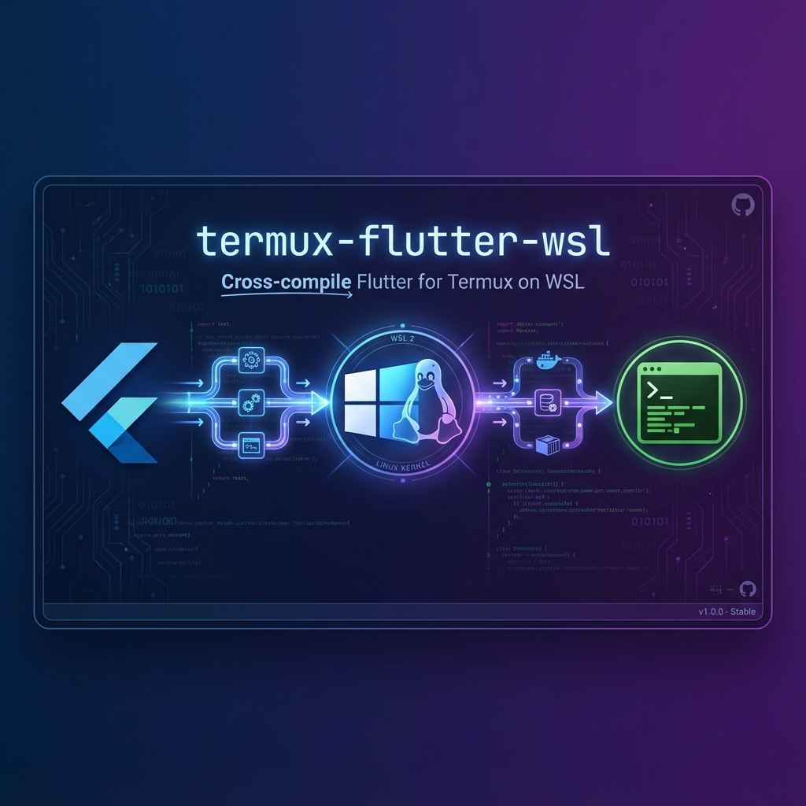
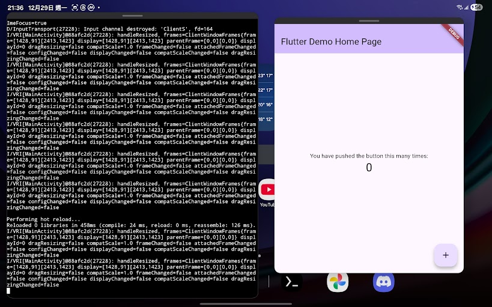

<p align="center">
  
</p>

# Flutter Termux

Run the Flutter SDK right on your phone with
[Termux](https://termux.dev). This project cross-compiles Flutter into a
`.deb` that installs straight into your Termux `$PREFIX`, so you get
`flutter run`, `flutter build apk`, and `flutter build linux` with no
computer in sight.

> **Looking for beta and main-channel builds?** This repo tracks Flutter
> **stable** only. For prereleases, grab them from
> [prerelease-flutter-for-termux](https://github.com/GeneralKaos666/prerelease-flutter-for-termux).

## What's inside

| Component | Version |
|-----------|---------|
| Flutter   | 3.47.7 (stable) |
| Dart      | 3.13.5 |
| Architecture | aarch64 (ARM64) only |
| Package   | `flutter_3.47.7-5_aarch64.deb` |

Every release ships with checksums and build evidence so you can verify
exactly what you installed:

- `flutter_<tag>-<pkg_rel>_aarch64.deb`
- `flutter_<tag>-<pkg_rel>_aarch64.deb.sha256`
- `flutter_<tag>-<pkg_rel>_aarch64.deb.size.txt`
- `inventory.txt`, `build_metadata.json`, `build_evidence.json`

## Quick start

Two commands and you're building Flutter apps on your phone.

### 1. Prepare Termux

You need an AArch64 (ARM64) device. Update everything and add the X11 repo:

```bash
pkg update && pkg upgrade
pkg install x11-repo
```

### 2. Run the installer

```bash
curl -sL https://raw.githubusercontent.com/GeneralKaos666/flutter-for-termux/main/install_flutter_complete.sh \
  -o install_flutter_complete.sh
bash install_flutter_complete.sh
```

The installer grabs the release package and sets up the Android
SDK/toolchain for you. When it finishes, check your setup:

```bash
flutter doctor -v
```

Full walkthrough and troubleshooting live in the
[Install guide](docs/guides/INSTALL_GUIDE.md).

## Manual install

Prefer to see every step? Do it by hand.

```bash
TAG=3.47.7
PKG_REL=5
DEB="flutter_${TAG}-${PKG_REL}_aarch64.deb"
BASE_URL="https://github.com/GeneralKaos666/flutter-for-termux/releases/download/${TAG}/"

curl -fSL -o "$DEB" "${BASE_URL}${DEB}"
curl -fSL -o "${DEB}.sha256" "${BASE_URL}${DEB}.sha256"
curl -fSL -o "${DEB}.size.txt" "${BASE_URL}${DEB}.size.txt"

# verify integrity
sha256sum -c "${DEB}.sha256"
test "$(cat "${DEB}.size.txt")" = "$(stat -c '%s' "$DEB")"

apt install "./${DEB}"
bash $PREFIX/share/flutter/post_install.sh
```

Flutter lands in `$PREFIX/opt/flutter`. To remove it later, run
`apt remove flutter`.

## Build your first APK

Create a project:

```bash
flutter create my_app
cd my_app
```

Configure it once for Termux (the script edits your Gradle files for you):

```bash
bash $PREFIX/share/flutter/flutter_project_config.sh
```

Or make the same two edits yourself:

`android/gradle.properties`:

```properties
android.aapt2FromMavenOverride=/data/data/com.termux/files/usr/bin/aapt2
```

`android/app/build.gradle.kts`:

```kotlin
android {
    compileSdk = 36
    targetSdk = 36
    defaultConfig {
        ndk {
            abiFilters += listOf("arm64-v8a")
        }
    }
}
```

> **Why compileSdk 36?** Termux ships aapt2 16.0.0.4, which loads the
> android-35/36 `android.jar`, so projects default to `compileSdk = 36` /
> `targetSdk = 36`. `post_install.sh` pins these via
> `flutter_project_config.sh` and falls back 36 → 35 → 34 only if the
> installed aapt2 can't load the newest platform. The engine builds against
> Android API 26 with weak imports, so this only affects the APK packaging
> tools. See the [AAPT2 analysis](docs/guides/AAPT2_RELEASE_BUILD_BUG_ANALYSIS.md).

Now build a debug APK:

```bash
flutter build apk --debug --no-tree-shake-icons
```

Your APK is waiting in `build/app/outputs/flutter-apk/`. Building an APK on
a phone is a good look.

## Hot reload

Connect a device or emulator over adb, then:

```bash
flutter devices
flutter run -d <device_id>
```

Edit your code, save, and watch the app update live:

<p align="center">
  
</p>

## More targets

### Linux desktop (Termux:X11)

Install [Termux:X11](https://github.com/termux/termux-x11/releases), then:

```bash
export DISPLAY=:0
termux-x11 :0 >/dev/null 2>&1 &
flutter run -d linux
```

### Web server

```bash
flutter run -d web-server --web-port 8080
```

Open `http://localhost:8080` in your browser and you're live.

## Build the package from source

Want to compile Flutter yourself? Run the full pipeline on a Linux x86-64
host (WSL2 or a self-hosted runner) with NDK r29, `dpkg`, and `ar`:

```bash
python3 -m pip install -r requirements.txt
export ANDROID_NDK=/opt/android-ndk-r29

python3 build.py clone
python3 build.py sync
python3 build.py sysroot --arch=arm64
python3 build.py configure --arch=arm64 --mode=release
python3 build.py build --arch=arm64 --mode=release
python3 build.py debuild --arch=arm64
```

Budget roughly 2-4 hours on 24 threads. Patches apply automatically during
`sync` via the `.gclient` `custom_hooks`, so don't run a `patch_*` step
right after (it fails with "already exists"). The
[Build guide](docs/guides/BUILD_GUIDE.md) covers details and troubleshooting.

## CI/CD

Releases build and publish themselves. The GitHub-hosted `Build` workflow
(`build.yml`) runs on `ubuntu-latest` after `CI` passes on `main`. A
self-hosted evidence-tracked fallback (`build-deb.yml`) and an ADB device
smoke gate (`device-smoke.yml`) handle manual runs, and the nightly
`autorelease.yml` picks up new Flutter stable versions and bumps
`build.toml` for you. See [CI/CD and device lab](docs/CI_CD.md).

## Documentation

- [Install guide](docs/guides/INSTALL_GUIDE.md) — on-device setup, first projects, troubleshooting.
- [Build guide](docs/guides/BUILD_GUIDE.md) — end-to-end source build, step-by-step commands, and troubleshooting.
- [Upgrade guide](docs/guides/UPGRADE_GUIDE.md) — moving to a new Flutter release.
- [Build process](docs/guides/BUILD_PROCESS.md) — build internals: pipeline stages, patches, GN toolchain, and sysroot design.
- [Changelog](docs/releases/CHANGELOG.md) — version history and notable fixes.
- [Release notes](docs/releases/RELEASE_NOTES.md) — GitHub release body.

## Limitations

- **ARM64 only.** `arm` and `x64` gen_snapshot builds fail (32-bit BoringSSL
  shift overflow / sysroot mismatch), so only the `aarch64` package ships.
- **Release mode by default.** Debug and profile need those steps rebuilt
  with `--mode=debug|profile`.
